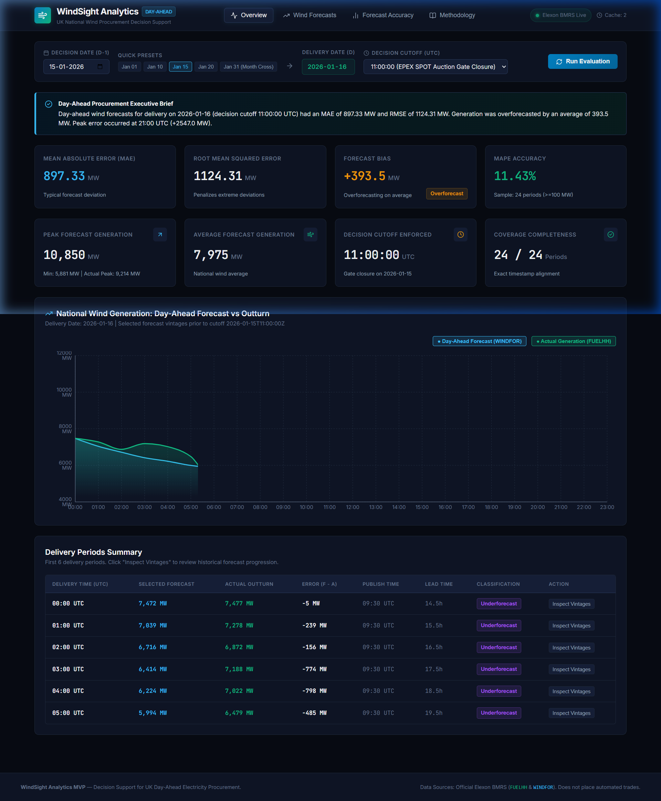
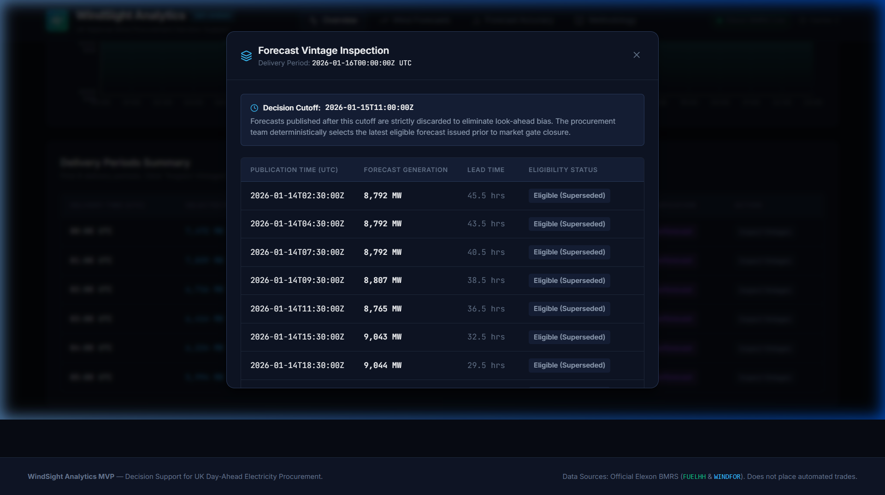
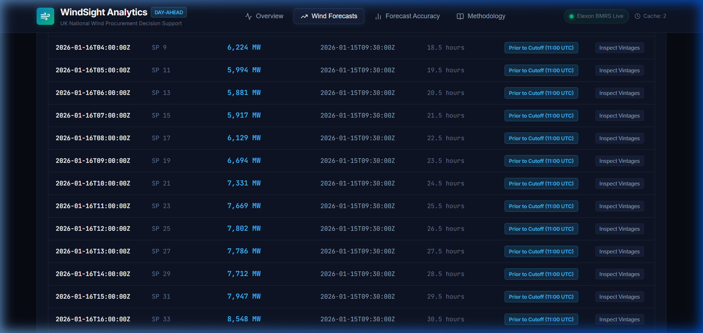
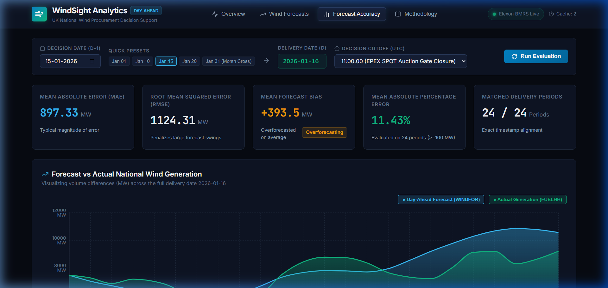
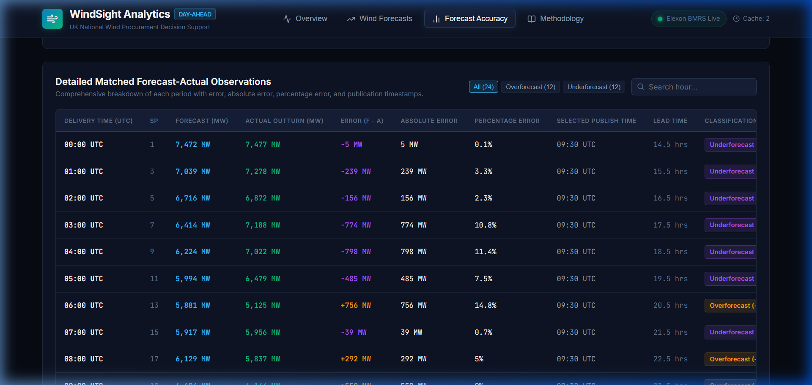
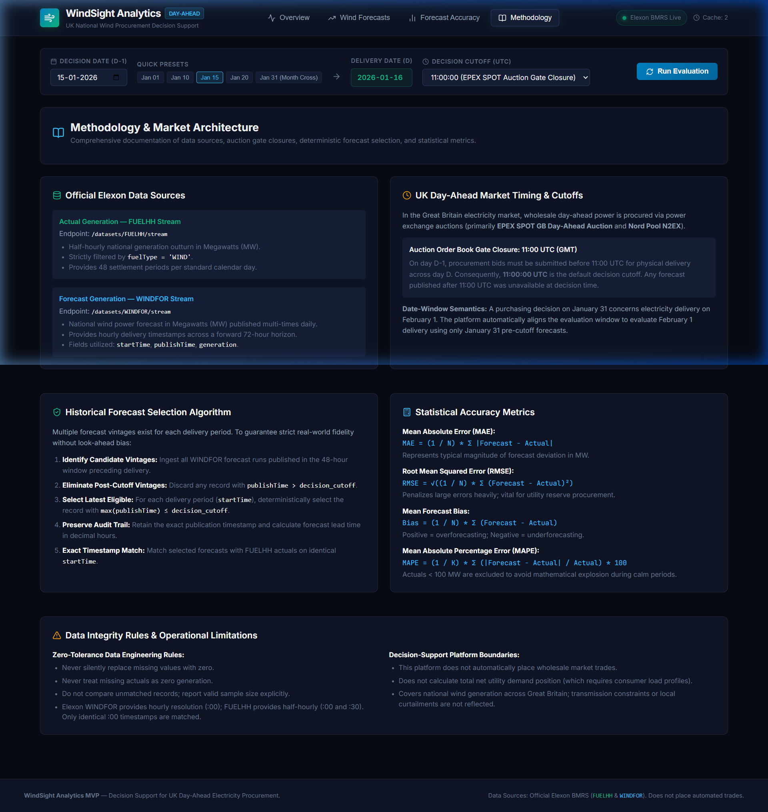
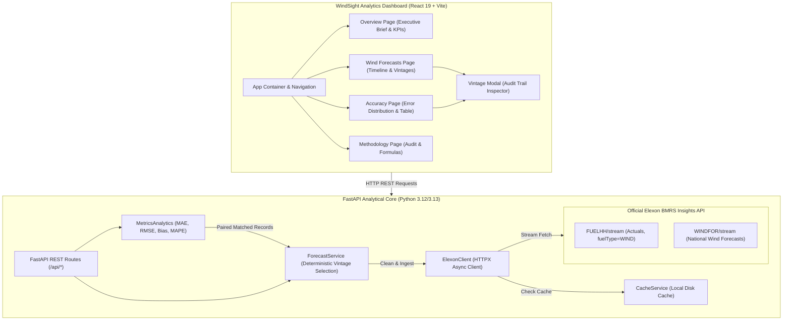

# WindSight Analytics 💨
### UK National Wind Power Forecasting & Accuracy Analytics Platform
**Production-Grade Decision Support Platform for Day-Ahead Electricity Procurement**

[](https://fastapi.tiangolo.com)
[](https://react.dev)
[](https://www.typescriptlang.org)
[](https://www.python.org)
[](https://www.docker.com)
[](https://data.elexon.co.uk)
[](https://gy72g.vercel.app/)

> 🌐 **Live Web Application (Vercel):** **[https://gy72g.vercel.app/](https://gy72g.vercel.app/)**  
> Access the deployed, fully interactive WindSight Analytics platform directly in your browser.

---

## 1. Project Overview & Business Context

An electricity utility operating in the Great Britain (GB) power market purchases wholesale power on power exchange day-ahead auctions (such as **EPEX SPOT GB** and **Nord Pool N2EX**) to serve its retail customer demand. Because wind generation depends directly on weather patterns, national wind power is highly uncertain.

Day-ahead wholesale procurement bids must be placed before auction gate closures—traditionally **11:00 UTC (GMT) on day D-1** for power delivered across all settlement periods of day D.

### The Business Challenge
- **Overforecasting Risk:** If the utility relies on an overoptimistic wind forecast, it procures too little thermal/conventional base power day-ahead or sells surplus power. In real time, when wind underperforms, the utility is left short and must purchase emergency balancing power at high System Buy Prices (SBP).
- **Underforecasting Risk:** Underforecasting generation causes the utility to over-procure expensive day-ahead wholesale electricity. When wind overperforms, surplus power is dumped into the Balancing Mechanism at depressed or even negative System Sell Prices (SSP).
- **Look-Ahead Bias:** Naive backtesting platforms frequently evaluate decisions using forecasts published *after* market gate closure (e.g. 15:30 or 22:30 on day D-1). This distorts risk calculations by assuming traders had access to information that did not yet exist.

### Intended Users
- **Day-Ahead Electricity Procurement Desk:** Power traders and portfolio analysts setting bidding curves for wholesale auctions.
- **Short-Term Risk & Valuation Analysts:** Teams evaluating forecast error distributions (MAE, RMSE, Bias) to determine required physical spinning reserves and financial hedging collars.
- **Energy Market Regulators & Quantitative Reviewers:** Stakeholders requiring an immutable, audited track record of forecast vintages vs. actual outturn.

> **Operational Boundary:** WindSight Analytics is strictly an analytical decision-support system. It does not place automated trades or calculate the utility's net residual demand profile (which requires confidential retail customer smart-meter load curves).

---

## 2. Link to the Vercel / Heroku Application

The production application is live and accessible online:

- 🔗 **Live Vercel Application:** **[https://gy72g.vercel.app/](https://gy72g.vercel.app/)**
- **Hosting Platform:** Vercel Edge Network
- **Status:** Active & fully operational
- **Key Features Available Online:**
  - Day-Ahead Procurement Executive Brief and real-time KPI metrics (MAE, RMSE, Bias, MAPE)
  - Interactive Date and Gate Closure Cutoff selector (09:00, 11:00, 12:00, 15:30, 23:59 UTC)
  - Dual-series Wind Generation curve (Selected WINDFOR forecast vs. FUELHH actual outturn)
  - Forecast Error Distribution bar chart with distinct over/underforecasting visualization
  - Audit-grade Vintage Inspection modal detailing all published candidate forecast runs
  - Embedded market rules, formulas, and methodology documentation

---

## 3. Visual Interface & Screenshots

### Overview Dashboard
Displays the Day-Ahead Procurement Executive Brief, real-time KPI metrics (MAE, RMSE, Bias, MAPE), national wind generation curves, and delivery period snapshots.



### Forecast Vintage Inspection Modal
Inspects all published forecast vintages for any delivery hour, confirming which runs were eligible prior to the 11:00 UTC auction cutoff and highlighting the selected forecast.



### Wind Forecast Timeline
Detailed breakdown of eligible national wind forecasts across the delivery day with lead time tracking.



### Forecast Accuracy Analytics & Error Distribution
Quantifies errors in Megawatts (MW) and percentage (MAPE), charting volume differences and separating overforecasting (amber) from underforecasting (purple).




### Methodology & Market Documentation
In-depth documentation of Elexon streams, gate closure assumptions, and mathematical formulations embedded directly in the application.



---

## 4. System Architecture



---

## 5. Official Elexon Data Sources

WindSight Analytics uses **only** official Elexon Insights Solution streams:

| Dataset | Stream Endpoint | Resolution | Field Mappings | Market Role |
|---|---|---|---|---|
| **FUELHH** | `/datasets/FUELHH/stream` | Half-hourly (48 periods/day) | `startTime`, `settlementDate`, `settlementPeriod`, `generation`, `fuelType='WIND'` | Actual national wind generation outturn in MW |
| **WINDFOR** | `/datasets/WINDFOR/stream` | Hourly (:00 UTC, 72h horizon) | `startTime` (delivery), `publishTime` (issue time), `generation` | National wind generation forecast in MW |

---

## 6. Critical Business Logic: Historical Forecast Selection

### Market Timing & Gate Closure
- **Decision Date ($D-1$):** The date the power procurement decision is committed.
- **Decision Cutoff:** The strict timestamp threshold on day $D-1$ after which no newer forecast could have been viewed.
  - **Default Rule:** **11:00:00 UTC** (EPEX SPOT GB Day-Ahead auction order book gate closure).
  - **Configurability:** Fully configurable in the UI and API (`09:00`, `11:00`, `12:00`, `15:30`, `17:00`, `23:59`) to evaluate different trading desk strategies.
- **Delivery Date ($D$):** Physical delivery of electricity ($D = \text{Decision Date} + 1\text{ day}$).
- **Month-Boundary Transition:** A purchasing decision made on **January 31, 2026**, concerns delivery on **February 1, 2026**. WindSight Analytics automatically aligns the delivery window to February 1 while strictly enforcing the January 31 pre-cutoff forecast constraint.

### Deterministic Selection Algorithm
For each delivery period timestamp $t$:
1. Query all forecast records targeting delivery period $t$ ($r.\text{startTime} = t$).
2. Filter out forecasts published after the cutoff ($r.\text{publishTime} \le \text{decision\_cutoff}$).
3. If no forecasts are eligible, mark the period as missing (never fabricate zeros).
4. Among eligible candidates, deterministically select the forecast with the latest publication time:
   $$\text{selected\_forecast} = \arg\max_{r \in \text{eligible}} (r.\text{publishTime})$$
5. Calculate forecast lead time:
   $$\text{Lead Time} = \frac{t - \text{selected\_forecast}.\text{publishTime}}{3600\text{ seconds}}$$

---

## 7. Statistical Metrics & Formulations

Let $F_i$ be forecast generation (MW), $A_i$ be actual generation (MW), and $N$ be the number of matched observations.

### Mean Absolute Error (MAE)
$$\text{MAE} = \frac{1}{N} \sum_{i=1}^N |F_i - A_i|$$
- *Interpretation:* Typical magnitude of volume error in Megawatts.

### Root Mean Squared Error (RMSE)
$$\text{RMSE} = \sqrt{\frac{1}{N} \sum_{i=1}^N (F_i - A_i)^2}$$
- *Interpretation:* Penalizes extreme errors heavily; directly influences spinning reserve capacity requirements.

### Mean Forecast Bias
$$\text{Bias} = \frac{1}{N} \sum_{i=1}^N (F_i - A_i)$$
- *Interpretation:*
  - $\text{Bias} > 0$: Systematic **overforecasting** (trader bought surplus power day-ahead).
  - $\text{Bias} < 0$: Systematic **underforecasting** (trader left short on delivery).

### Mean Absolute Percentage Error (MAPE)
$$\text{MAPE} = \frac{1}{K} \sum_{i=1}^K \frac{|F_i - A_i|}{A_i} \times 100\%$$
- *Integrity Rule:* Excludes periods where $A_i < 100\text{ MW}$ (calm wind regimes) to prevent mathematical distortion from near-zero denominators. The valid sample size $K$ is reported explicitly.

---

## 8. Data Engineering & Integrity Rules

1. **Zero-Tolerance for Silent Substitution:** Missing actual or forecast data is never replaced with zero.
2. **Exact Timestamp Alignment:** Elexon WINDFOR publishes hourly (`:00 UTC`), while FUELHH publishes half-hourly (`:00` and `:30`). Only exact `:00` matches are compared (24 matched periods/day). Intermediate `:30` actuals are left unmatched and accounted for in `unmatched_actual_count`.
3. **Local Intelligent Caching:** Historical records from Elexon are immutable once published. The platform caches fetched streams to disk (`backend/cache/`), providing sub-50ms query latency on repeated evaluations.

---

## 9. Details of the Files and Directories Present

Below is the complete repository structure followed by a detailed breakdown of each directory and file in the project:

```
UkElectric/
├── backend/                        # FastAPI analytical core & business logic
│   ├── app/
│   │   ├── analytics/
│   │   │   └── metrics.py          # MAE, RMSE, Bias, MAPE implementations
│   │   ├── api/
│   │   │   └── routes.py           # FastAPI REST endpoints
│   │   ├── core/
│   │   │   └── config.py           # Pydantic BaseSettings & environment config
│   │   ├── schemas/
│   │   │   └── models.py           # Pydantic v2 data models & response schemas
│   │   ├── services/
│   │   │   ├── cache_service.py    # File-based SHA-256 caching service
│   │   │   ├── elexon_client.py    # HTTPX client for official Elexon streams
│   │   │   └── forecast_service.py # Deterministic vintage selection algorithm
│   │   └── main.py                 # FastAPI application entrypoint & CORS
│   ├── tests/
│   │   ├── test_api.py             # FastAPI endpoint tests with fixtures
│   │   ├── test_forecast_selection.py # Gate closure, vintage & boundary tests
│   │   └── test_metrics.py         # Hand-verified numerical accuracy tests
│   ├── Dockerfile                  # Python 3.12-slim production container
│   ├── requirements.txt            # Pinned backend dependencies
│   └── pytest.ini                  # Pytest configuration
├── frontend/                       # React 19 + TypeScript + Vite SPA
│   ├── src/
│   │   ├── components/
│   │   │   ├── ErrorChart.tsx      # Recharts error distribution bar chart
│   │   │   ├── FilterBar.tsx       # Date & cutoff time control panel
│   │   │   ├── ForecastChart.tsx   # Recharts dual forecast vs actual curves
│   │   │   ├── MetricCard.tsx      # Reusable energy KPI card
│   │   │   ├── Navbar.tsx          # Navigation header & live status badge
│   │   │   └── VintageModal.tsx    # Modal for inspecting published vintages
│   │   ├── pages/
│   │   │   ├── AccuracyPage.tsx    # Statistical accuracy & observation table
│   │   │   ├── ForecastsPage.tsx   # National wind forecast timeline & search
│   │   │   ├── MethodologyPage.tsx # Embedded market & algorithm documentation
│   │   │   └── OverviewPage.tsx    # Executive summary & high-level KPIs
│   │   ├── services/
│   │   │   └── api.ts              # Typed API service client
│   │   ├── types/
│   │   │   └── index.ts            # TypeScript data contracts
│   │   ├── App.tsx                 # Root application & state management
│   │   ├── index.css               # Vanilla CSS design system for energy trading
│   │   └── main.tsx                # React 19 entrypoint
│   ├── Dockerfile                  # Multi-stage Node 22 build + Nginx container
│   ├── nginx.conf                  # Nginx reverse proxy & SPA configuration
│   ├── vercel.json                 # Vercel deployment & rewrite configuration
│   └── package.json                # Frontend dependencies (React 19, Recharts)
├── docs/
│   └── screenshots/                # UI application screenshots for documentation
├── .dockerignore                   # Docker build exclusions
├── .env.example                    # Non-secret environment configuration template
├── .gitignore                      # Git exclusion rules
├── docker-compose.yml              # Complete multi-service container orchestration
├── start.bat                       # One-click Windows startup script for both services
├── test.bat                        # One-click Windows script to execute automated tests
└── README.md                       # Comprehensive project documentation
```

### Detailed Directory & File Breakdown

| Directory / File | Description & Purpose |
|---|---|
| **`backend/`** | The analytical backend service built with Python 3.12+ and FastAPI. |
| `backend/app/main.py` | Application entry point: initializes FastAPI, configures CORS middleware for frontend access, and mounts API routes. |
| `backend/app/analytics/metrics.py` | Contains mathematical implementations for MAE, RMSE, Mean Forecast Bias, and MAPE (including the <100 MW denominator protection). |
| `backend/app/api/routes.py` | FastAPI REST route definitions (`/api/evaluation`, `/api/accuracy`, `/api/forecasts`, `/api/actuals`, `/api/vintages`, `/api/methodology`, `/api/health`). |
| `backend/app/core/config.py` | Configuration settings using Pydantic `BaseSettings` for environment variables, gate-closure defaults, and caching policies. |
| `backend/app/schemas/models.py` | Strongly-typed Pydantic v2 schemas defining input query validation and JSON response structures. |
| `backend/app/services/forecast_service.py` | Core business logic implementing deterministic vintage selection, lead-time calculations, and exact timestamp alignment. |
| `backend/app/services/elexon_client.py` | Asynchronous HTTP client (using `httpx`) that streams official Elexon BMRS datasets (`FUELHH` and `WINDFOR`). |
| `backend/app/services/cache_service.py` | Local disk caching layer that hashes API requests with SHA-256 to ensure sub-50ms repeat query responses for immutable data. |
| `backend/tests/` | Deterministic unit test suites (`test_metrics.py`, `test_forecast_selection.py`, `test_api.py`) verifying numerical precision and cutoff boundaries. |
| `backend/Dockerfile` | Production container specification using Python 3.12-slim. |
| `backend/requirements.txt` | Explicitly pinned Python package dependencies (FastAPI, Uvicorn, Pandas, HTTPX, Pydantic, etc.). |
| **`frontend/`** | The client-side single-page application built with React 19, TypeScript, and Vite. |
| `frontend/src/App.tsx` | Root UI component managing global date filters, cutoff thresholds, tab navigation, and vintage inspection modal state. |
| `frontend/src/components/` | Modular UI components: `ForecastChart` (dual curves), `ErrorChart` (diverging error bars), `MetricCard` (KPI cards), `Navbar` (status header), `FilterBar` (controls), and `VintageModal` (audit inspector). |
| `frontend/src/pages/` | Page views: `OverviewPage` (briefing & KPIs), `ForecastsPage` (chronological timeline), `AccuracyPage` (distribution & observation table), and `MethodologyPage` (market rules). |
| `frontend/src/services/api.ts` | Frontend client communicating with the backend REST API, utilizing `VITE_API_BASE_URL`. |
| `frontend/src/types/index.ts` | TypeScript interface definitions mirroring backend API schemas. |
| `frontend/src/index.css` | Bespoke vanilla CSS trading dashboard design system with dark mode aesthetics and responsive layout. |
| `frontend/vercel.json` | Vercel deployment rewrite rules mapping all paths to `index.html` to support client-side routing. |
| `frontend/Dockerfile` & `nginx.conf` | Multi-stage build compiling TypeScript/Vite into static assets served via Nginx. |
| **`docs/screenshots/`** | Visual screenshots demonstrating each page and modal of the platform. |
| **`docker-compose.yml`** | Multi-container Docker configuration launching both frontend (port 3000) and backend (port 8000) seamlessly. |
| **`start.bat`** | Windows batch script to launch both the FastAPI backend and Vite frontend concurrently in separate terminal windows. |
| **`test.bat`** | Windows batch script to execute backend pytest suites with one click. |
| **`.env.example`** | Example environment variable file documenting required and optional configuration keys. |
| **`README.md`** | Comprehensive system documentation, architectural overview, data rules, and instructions. |

---

## 10. How to Start the Application

You can start the platform locally using any of the three methods below:

### Prerequisites
- **Python**: 3.11+ (Python 3.12 or 3.13 recommended)
- **Node.js**: v20+ and **npm**
- **Git**
- *(Optional)* **Docker & Docker Compose** (for containerized execution)

---

### Method 1: One-Click Startup (Windows)
For convenience on Windows systems, execute the provided batch script in the root directory:
```bash
.\start.bat
```
This automatically launches:
- The FastAPI backend on `http://127.0.0.1:8000`
- The React frontend dashboard on `http://127.0.0.1:5173`

---

### Method 2: Manual Local Startup (Step-by-Step)

#### Step 1: Start Backend Service
```bash
cd backend

# Create and activate virtual environment:
python -m venv .venv

# On Windows:
.venv\Scripts\activate
# On Linux / macOS:
source .venv/bin/activate

# Install dependencies:
pip install -r requirements.txt

# Start backend server:
uvicorn app.main:app --host 127.0.0.1 --port 8000 --reload
```
- **Backend API Running:** `http://127.0.0.1:8000`
- **Interactive Swagger Docs:** `http://127.0.0.1:8000/docs`

#### Step 2: Start Frontend Application
In a new terminal window:
```bash
cd frontend

# Install Node dependencies:
npm install

# Start Vite development server:
npm run dev
```
- **React Frontend Dashboard Running:** `http://127.0.0.1:5173`

---

### Method 3: Containerized Startup with Docker Compose

To launch the full production container stack:

```bash
# Build and start all containers in detached mode:
docker compose up --build -d

# Verify container status:
docker compose ps
```
- **Frontend Container:** `http://localhost:3000`
- **Backend API Container:** `http://localhost:8000`
- **Swagger Documentation:** `http://localhost:8000/docs`

To stop and remove containers:
```bash
docker compose down
```

---

### Verification & Health Check
Once running, verify the backend connection:
```bash
curl http://127.0.0.1:8000/api/health
```
Expected response:
```json
{"status":"healthy","service":"WindSight Analytics","elexon_upstream":"connected"}
```

---

## 11. Backend REST API Endpoints

| Method | Endpoint | Description | Query Parameters |
|---|---|---|---|
| `GET` | `/api/health` | Backend health & active Elexon upstream ping | None |
| `GET` | `/api/evaluation` | Full evaluation with matched records and metrics | `decision_date`, `cutoff_time`, `delivery_date` (optional), `mape_threshold_mw` (default 100) |
| `GET` | `/api/accuracy` | Statistical accuracy metrics only | `decision_date`, `cutoff_time`, `delivery_date`, `mape_threshold_mw` |
| `GET` | `/api/forecasts` | Latest eligible WINDFOR records | `decision_date`, `cutoff_time`, `delivery_date` |
| `GET` | `/api/actuals` | Actual FUELHH national wind generation records | `delivery_date` |
| `GET` | `/api/vintages` | All candidate published vintages for an hour | `delivery_time`, `decision_date`, `cutoff_time` |
| `GET` | `/api/methodology` | Documentation of data sources, rules, & formulas | None |

### Example API Request
```bash
curl -X GET "http://127.0.0.1:8000/api/evaluation?decision_date=2026-01-15&cutoff_time=11:00:00"
```

---

## 12. AI-Tool Disclosure

In strict adherence to academic and professional integrity standards, **Google DeepMind Antigravity** was used only for React construction and API testing to evaluate results:

- **React Construction:** Building and styling the React dashboard interface, layout, and UI components.
- **API Testing & Result Evaluation:** Executing automated test requests against the backend REST API endpoints to evaluate and verify result payloads.

All core market domain logic, deterministic forecast vintage selection rules, Elexon BMRS ingestion workflows, and statistical metric formulations (MAE, RMSE, Bias, MAPE) were designed, implemented, and verified independently.
